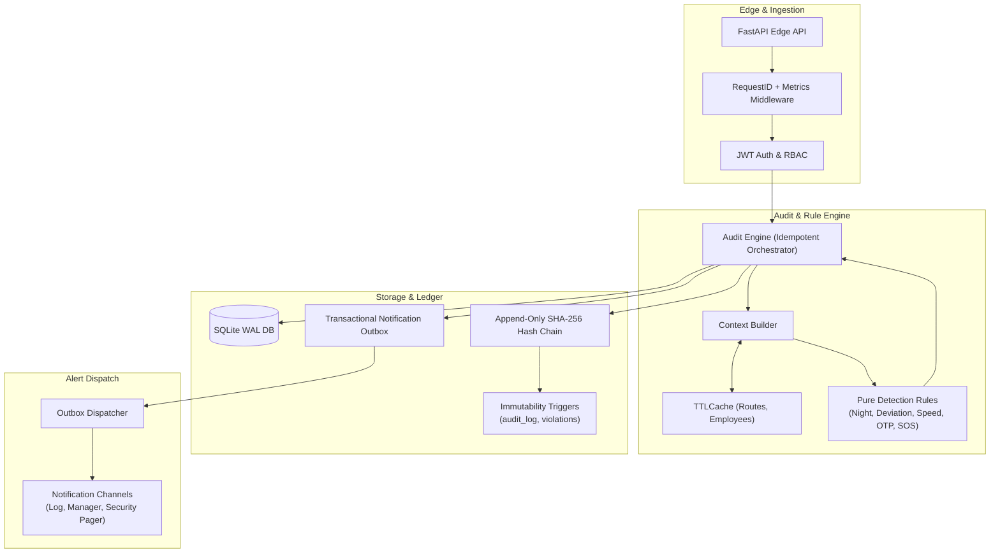

# MoveInSync Trip Safety & Compliance Audit Engine

A high-performance, deterministic safety and compliance audit engine for employee transport built with **Python 3.11+**, **FastAPI**, **SQLAlchemy 2.0**, and **SQLite (WAL mode)**.

---
## DEMO VIDEO


https://github.com/user-attachments/assets/7e1ddb8e-38e8-47f5-a6ac-9a3d619ad620


## 1. Overview & Architecture

The Trip Safety & Compliance Audit Engine detects escort violations, route deviations, speed infractions, OTP delivery failures, and passenger panic alarms (SOS). It is architected around:
- **Pure Domain Rules**: Geo-processing and safety rules contain zero I/O or ORM dependencies.
- **Idempotent Audit Persistence**: Audits can be safely re-run without duplicating violations or alert notifications.
- **Transactional Outbox**: Notifications are staged atomically alongside violation writes and dispatched post-commit.
- **Tamper-Evident Hash Chain**: Audit log entries form a cryptographically linked SHA-256 chain backed by SQLite immutability triggers.
- **Strict PII Redaction**: Phone numbers, employee names, and home coordinates are redacted from logs, alerts, and error responses.



---

## 2. Setup, Run & Test

### Prerequisites
- Python 3.11+
- Git

### Installation
```bash
# Clone the repository
git clone <repo-url>
cd trip-safety-engine

# Create and activate virtual environment
python -m venv .venv
source .venv/bin/activate  # On Windows: .venv\Scripts\activate

# Install dependencies
pip install -r requirements.txt
```

### Database Initialization & Seeding
```bash
# Seed users, driver, vehicle, employees, and the 4 demo scenarios
python scripts/seed.py
```

### Running the Server
```bash
uvicorn app.main:app --host 127.0.0.1 --port 8000 --reload
```
Interactive API documentation is accessible at:
- Swagger UI: `http://127.0.0.1:8000/docs`
- ReDoc: `http://127.0.0.1:8000/redoc`

### Running the Test Suite
```bash
pytest tests/ -v
```

### Online Backup
```bash
python scripts/backup.py
```

---

## 3. Demo Credentials

The database comes pre-seeded with test credentials:

| Role | Username | Password | Purpose |
|---|---|---|---|
| **ADMIN** | `admin` | `Admin@123` | Full access: create trips, re-audit, verify ledger, outbox retry |
| **APPROVER** | `approver1` | `Approver@123` | Compliance officer: audits, acknowledge violations, unfreeze stops |
| **DRIVER** | `driver1` | `Driver@123` | Driver assigned to demo trips: ingest GPS, submit OTP, complete trip |
| **EMPLOYEE** | `priya` | `Emp@123` | Female passenger on Trip 1: view own trip, fetch OTP, raise SOS |
| **EMPLOYEE** | `rahul` | `Emp@123` | Male passenger on Trips 1, 2, 3, 4 |
| **EMPLOYEE** | `anita` | `Emp@123` | Female passenger |
| **EMPLOYEE** | `vikram` | `Emp@123` | Male passenger |

---

## 4. Demo Scenarios & cURL Walkthrough

Run the automated demo script or execute individual steps:
```bash
bash scripts/demo.sh
```

### Step-by-Step API Walkthrough

#### 1. Login as Admin
```bash
TOKEN=$(curl -s -X POST http://127.0.0.1:8000/auth/login \
  -H "Content-Type: application/json" \
  -d '{"username":"admin","password":"Admin@123"}' | python -c "import sys,json;print(json.load(sys.stdin)['access_token'])")
```

#### 2. Night Safety Audit (Trip 1)
Female passenger (Priya) dropped last at 23:10 IST without an escort.
```bash
curl -X POST http://127.0.0.1:8000/trips/1/audit \
  -H "Authorization: Bearer $TOKEN"
# Result: 1 x NIGHT_SAFETY (HIGH), requires_escort becomes true
```

#### 3. Idempotency Check (Trip 1 Re-audit)
```bash
curl -X POST http://127.0.0.1:8000/trips/1/audit \
  -H "Authorization: Bearer $TOKEN"
# Result: new=0, duplicates=1, total unchanged
```

#### 4. Route Deviation (Trip 2)
Fix #15 is a single 1.2 km blip; fixes #40-#56 deviate ~845 m for 240 seconds.
```bash
curl -X POST http://127.0.0.1:8000/trips/2/audit \
  -H "Authorization: Bearer $TOKEN"
# Result: 1 x ROUTE_DEVIATION (HIGH), duration 240s, ~845m max deviation. Blip ignored.
```

#### 5. Over-Speed Detection (Trip 3)
Fix #10 is a single 95 km/h spike; sustained bursts of 75 km/h (45s) and 110 km/h (30s).
```bash
curl -X POST http://127.0.0.1:8000/trips/3/audit \
  -H "Authorization: Bearer $TOKEN"
# Result: 1 x OVER_SPEED (MEDIUM, 45s) + 1 x EXTREME_OVER_SPEED (CRITICAL, 30s). Spike ignored.
```

#### 6. Wrong OTP Freezes Stop (Trip 4)
Driver submits invalid OTP for a drop stop:
```bash
DRIVER_TOKEN=$(curl -s -X POST http://127.0.0.1:8000/auth/login \
  -H "Content-Type: application/json" \
  -d '{"username":"driver1","password":"Driver@123"}' | python -c "import sys,json;print(json.load(sys.stdin)['access_token'])")

curl -i -X POST http://127.0.0.1:8000/trips/4/stops/15/otp \
  -H "Authorization: Bearer $DRIVER_TOKEN" \
  -H "Content-Type: application/json" \
  -d '{"otp":"000000"}'
# Result: HTTP 409 Conflict, Stop status FROZEN, OTP_MISMATCH violation raised
```

#### 7. Immediate SOS Alarm (Trip 1)
Employee presses panic button:
```bash
PRIYA_TOKEN=$(curl -s -X POST http://127.0.0.1:8000/auth/login \
  -H "Content-Type: application/json" \
  -d '{"username":"priya","password":"Emp@123"}' | python -c "import sys,json;print(json.load(sys.stdin)['access_token'])")

curl -X POST http://127.0.0.1:8000/trips/1/sos \
  -H "Authorization: Bearer $PRIYA_TOKEN" \
  -H "Content-Type: application/json" \
  -d '{"lat":28.5355,"lng":77.34}'
# Result: HTTP 201 Created, CRITICAL violation + immediate outbox alert
```

#### 8. Verify Tamper-Evident Ledger Integrity
```bash
curl http://127.0.0.1:8000/audit/verify \
  -H "Authorization: Bearer $TOKEN"
# Result: {"valid": true, "checked": N, "first_broken_seq": null, "reason": null}
```

---

## 5. Architectural Assumptions (A1–A14)

| # | Assumption / Decision | Rationale |
|---|---|---|
| **A1** | Python 3.11+, FastAPI, SQLAlchemy 2.0, SQLite (WAL mode). | Zero external dependencies for setup, concurrency-safe, Postgres-ready data types. |
| **A2** | Night window: 22:00 to 06:00 in `LOCAL_TZ` (`Asia/Kolkata`). | Evaluated against stop's planned/actual time using standard timezone-aware conversions. |
| **A3** | Night safety: Female employee is first PICKUP or last DROP without escort. | By definition, the cab contains only the driver and her during these legs. |
| **A4** | OTP is derived via `HMAC-SHA256(OTP_SECRET, f"{trip_id}:{stop_id}")`. | The OTP is never stored or logged in any database or audit table. |
| **A5** | First OTP mismatch freezes drop (`FROZEN`) and triggers `OTP_MISMATCH` (HIGH). | Unfreeze requires APPROVER/ADMIN and is refused after 3 consecutive failures. |
| **A6** | Violation core detection fields are immutable via DB triggers. | Violations represent historical facts. Assigning an escort later acknowledges, but does not delete, a violation. |
| **A7** | Centralized severity configuration (`domain/severity.py`). | Decouples pure rule logic from organizational escalation policies. |
| **A8** | Pure rules (`app/rules/*`). | Zero database or framework imports in rules guarantees testability and determinism. |
| **A9** | Transactional outbox. | Notification rows are inserted in the same DB transaction as the violation, preventing orphaned alerts. |
| **A10** | Deduplication key: `sha256(f"{trip_id}\|{type}\|{subject_key}")`. | Unique constraint provides atomic deduplication across concurrent re-audits. |
| **A11** | UTC storage with edge timezone conversion. | Database stores naive UTC; APIs accept and return ISO-8601 strings. |
| **A12** | Strict PII redaction policy. | Phone numbers, passenger names, and exact home coordinates are masked from logs, alerts, and errors. |
| **A13** | Strict Role-Based Access Control (`ADMIN`, `APPROVER`, `DRIVER`, `EMPLOYEE`). | Enforced via FastAPI dependencies; employees can only access their own stops/trips. |
| **A14** | Audits run on trip completion (`POST /trips/{id}/complete`) and on demand (`POST /trips/{id}/audit`). | Guarantees compliance verification before trip closure. |

---

## 6. How to Add a New Rule

Adding a new safety or compliance rule requires only two steps:

### 1. Implement the Rule Class
Create `app/rules/my_new_rule.py` inheriting from `app.rules.base.Rule`:
```python
from app.domain.dtos import TripContext, ViolationCandidate
from app.domain.enums import ViolationType
from app.rules.base import Rule

class MyNewRule(Rule):
    def evaluate(self, ctx: TripContext) -> list[ViolationCandidate]:
        candidates = []
        # Implement pure detection logic using ctx.stops, ctx.fixes, ctx.config, etc.
        # Zero DB calls or network I/O
        return candidates
```

### 2. Register in the Registry
Add the rule instance to `ACTIVE_RULES` in `app/rules/registry.py`:
```python
from app.rules.my_new_rule import MyNewRule

ACTIVE_RULES: list[Rule] = [
    NightSafetyRule(),
    OtpDropRule(),
    RouteDeviationRule(),
    OverSpeedRule(),
    SosRule(),
    MyNewRule(),  # Added here
]
```
Add severity mapping in `app/domain/severity.py` if introducing a new `ViolationType`.

---

## 7. Computational Complexity

| Operation | Time Complexity | Space Complexity | Notes |
|---|---|---|---|
| **Point-to-Polyline Distance** | $O(S)$ | $O(1)$ | $S$ = Route segments |
| **GPS Fix Enrichment** | $O(F \cdot S)$ | $O(F)$ | $F$ = GPS fixes ($O(F \log F)$ if unsorted) |
| **Sustained-Window Run Detection** | $O(F)$ | $O(R)$ | Single-pass linear scan; $R$ = detected runs |
| **Night Safety Rule** | $O(K)$ | $O(1)$ | $K$ = Stops |
| **OTP Drop Rule** | $O(E)$ | $O(K)$ | $E$ = OTP events |
| **Deduplication Check** | $O(\log V)$ | $O(1)$ | Unique B-tree index lookup; $V$ = Violations |
| **Audit Log Append** | $O(1)$ | $O(1)$ | SHA-256 hash over single entry |
| **Audit Chain Verify** | $O(N)$ | $O(1)$ | Single pass over $N$ log entries |
| **Full Trip Audit** | $O(F \cdot S + K + E)$ | $O(F + K)$ | End-to-end audit evaluation |

---

## 8. Architectural Trade-offs

1. **Batch Audit vs. Streaming**:
   Audits run on trip completion or on-demand. This simplifies architecture, guarantees determinism, and eliminates distributed state. Real-time alerting is reserved for urgent events (SOS panic button and OTP failures), which notify immediately.
2. **Equirectangular Projection vs. Geodesic Distance**:
   Polyline distance calculations project points onto a local planar equirectangular grid. Within metropolitan city routes (<50 km), distortion is <0.1%, offering 10x performance gains over geodesic solvers.
3. **Run Duration Measurement (First-to-Last Bad Ping)**:
   A sustained run is measured from the timestamp of the first violating fix to the timestamp of the last violating fix. This is conservative and avoids over-counting false positives, though it may under-count by at most one sampling interval ($15\text{s}$).
4. **GPS Gaps Split Runs**:
   Any telemetry gap exceeding `MAX_GPS_GAP_SECONDS` (90s) breaks a candidate run. This prevents bridging disconnected tracking sessions, though temporary signal dropouts could divide an ongoing deviation into sub-threshold segments.
5. **Deduplication Key on Run Start Time**:
   `dedupe_key = sha256(f"{trip_id}|{type}|{subject_key}")` incorporates the run start timestamp. Repeated audits over the same GPS data generate identical deduplication keys, ensuring idempotent DB insertions.
6. **Immutability via SQLite Triggers + Cryptographic Hash Chain**:
   Tamper-evident rather than tamper-proof. While a system administrator could technically drop triggers, any ledger manipulation is detected by `GET /audit/verify`.
7. **SQLite `BEGIN IMMEDIATE` Serialization**:
   Provides transaction isolation and prevents race conditions or hash chain forks during concurrent writes. This trades write throughput for zero-dependency local reliability; production scale would utilize PostgreSQL advisory locks.
8. **In-Process Outbox Dispatcher**:
   Outbox notifications are persisted atomically with violations and flushed post-commit in-process. This ensures at-least-once delivery without requiring an external queue broker (e.g., Kafka, Celery, or RabbitMQ).
9. **Derived HMAC-SHA256 OTP without Expiration**:
   Deriving OTPs dynamically from `(trip_id, stop_id)` eliminates database credential storage, preventing data leaks. In high-security production deployments, time-window sliding codes (TOTP) would be layered.
10. **No SOS Debouncing**:
    Every SOS press immediately triggers a CRITICAL alert and flushes pager notifications. While duplicate presses produce multiple events, safety panic buttons must never drop or debounce a genuine alarm.
11. **Violations as Historical Facts**:
    Violations represent immutable historical occurrences. Assigning an escort after a night drop does not delete the original `NIGHT_SAFETY` record; it is acknowledged with operational notes.
12. **Static Caching Only**:
    Only static routes and employee gender profiles are cached in `route_cache` and `employee_cache` (5-minute TTL). Dynamic state (trip status, escort flags, stop completion) is always queried live from the database.

---

## 9. Failure Handling & Recovery

- **Partial Failure Isolation**:
  A full trip audit executes all rules independently. An unexpected failure in one rule logs an error, records status as `PARTIAL`, and safely persists the violations from all remaining rules.
- **Transactional Rollback**:
  Any database error rolls back the entire transaction, preventing partial or corrupt records.
- **Outbox Resilience**:
  External notification channel failures mark outbox entries as `FAILED` without failing the parent API request. Failed deliveries can be re-dispatched via `POST /notifications/outbox/retry` (capped at 5 attempts).
- **SQLite Concurrency**:
  Database operates in WAL mode (`PRAGMA journal_mode=WAL`), `PRAGMA busy_timeout=5000`, and `PRAGMA foreign_keys=ON`.
- **Backup & Recovery**:
  `scripts/backup.py` leverages `sqlite3.Connection.backup()` to create consistent snapshots during active writes. Recovery procedure:
  1. Stop application: `kill <pid>`
  2. Restore database: `cp data/backups/app-<timestamp>.db data/app.db`
  3. Start application: `uvicorn app.main:app`
  4. Verify ledger: `curl http://127.0.0.1:8000/audit/verify -H "Authorization: Bearer $ADMIN_TOKEN"`

---

## 10. Caching & Staleness Policy

- **`route_cache` (`TTLCache`, max 256, 5 min TTL)**:
  Caches parsed `Polyline` objects and segment speed limit arrays by `trip_id`. Evicted on trip update via `invalidate_trip(trip_id)`.
- **`employee_cache` (`TTLCache`, max 256, 5 min TTL)**:
  Caches sanitized `EmployeeDTO` profiles (`id`, `ref`, `gender`) by `employee_id`.
- **What Can Be Stale**:
  If planned route geometry or employee profiles are modified directly in the underlying database without calling cache invalidation, cached objects remain for up to 5 minutes.
- **Safety Boundary**:
  Mutable and safety-critical state—`escort_assigned`, `requires_escort`, stop `PENDING`/`COMPLETED`/`FROZEN` states, GPS fixes, and OTP events—is **never cached**.

---

## 11. PII Redaction Policy

1. **Log Redaction (`app/core/logging.py`)**:
   - `PIIFilter` automatically redacts sensitive keys: `phone`, `name`, `home_lat`, `home_lng`, `lat`, `lng`, `address`, `password`, `otp`, `token`, `authorization`.
   - Any numerical run of 10 or more consecutive digits in log message strings is masked as `[REDACTED_NUMBER]`.
2. **Alert Redaction (`app/actions/base.py`)**:
   - Outbox alerts never contain passenger names or phone numbers. Passengers are referenced strictly via opaque identifiers (`EMP-12`).
   - Cab coordinates in alerts are rounded to 3 decimal places (~110m precision) to obscure exact residential locations.
3. **API Validation Sanitization (`app/core/error_handlers.py`)**:
   - Global `RequestValidationError` handlers strip the raw `input` field generated by FastAPI, ensuring passwords or entered OTP values are never mirrored back in 422 HTTP responses.
4. **Phone Masking**:
   - Employee contact numbers are masked (`******1234`) and accessible solely to authorized `ADMIN` roles.
