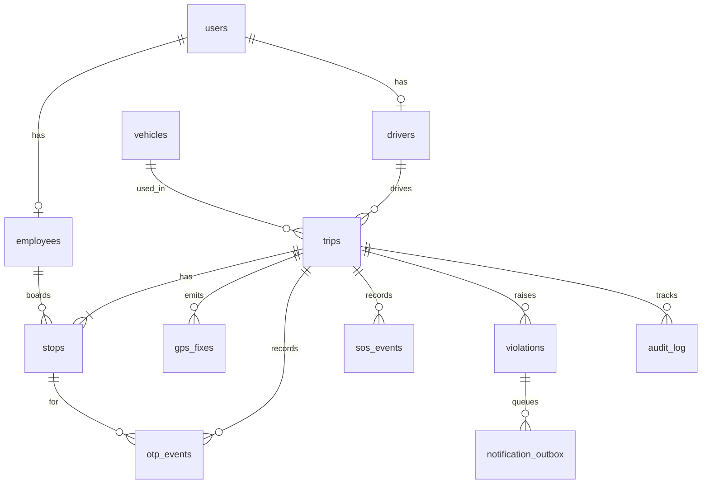
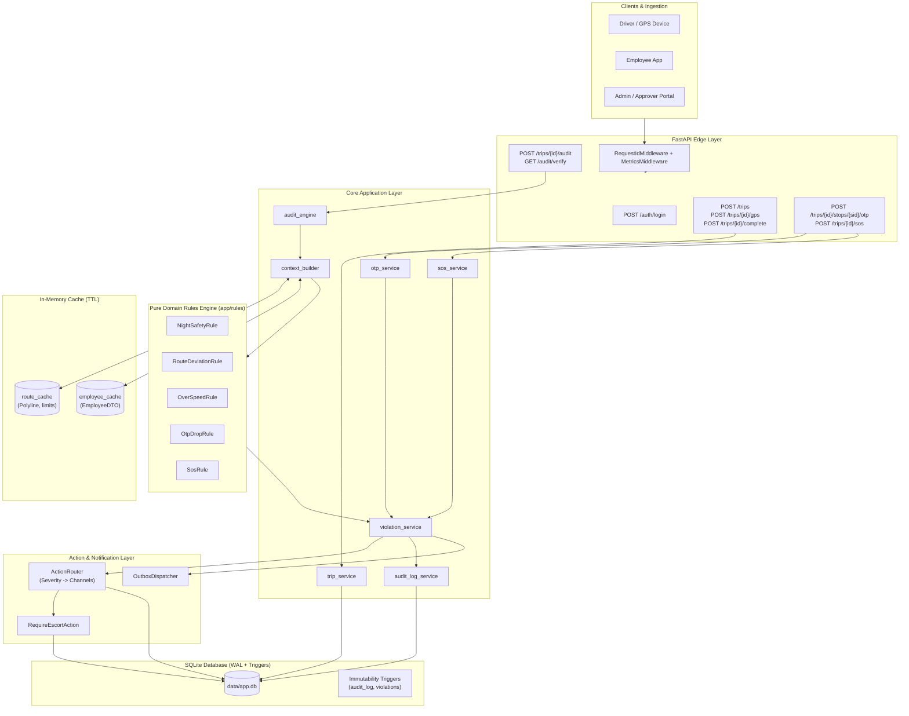

# Trip Safety & Compliance Audit Engine: ER & Architecture Diagrams

## 1. Entity-Relationship Diagram

### Table Definitions Summary
- **`users`**: System identities with RBAC roles (`ADMIN`, `APPROVER`, `DRIVER`, `EMPLOYEE`).
- **`employees`**: Employee profiles (`user_id`, `name`, `gender`, `phone`).
- **`drivers`**: Driver profiles (`user_id`, `name`, `license_no`).
- **`vehicles`**: Vehicle information (`reg_no`, `model`).
- **`trips`**: Trip master records (`planned_route`, `segment_speed_limits`, `default_speed_limit_kmph`, `status`, `escort_assigned`, `requires_escort`).
- **`stops`**: Pickups and drops per trip (`sequence`, `type`, `employee_id`, `planned_time`, `actual_time`, `lat`, `lng`, `status`, `otp_failures`).
- **`gps_fixes`**: Raw GPS pings (`trip_id`, `ts`, `lat`, `lng`, `speed_kmph`).
- **`otp_events`**: Drop OTP verification audit trail (`attempt_no`, `success`, `ts`). *No OTP values stored.*
- **`sos_events`**: Panic alarms triggered by passengers (`employee_id`, `location_source`, `lat`, `lng`, `ts`).
- **`violations`**: Immutable safety violations (`trip_id`, `type`, `severity`, `dedupe_key`, `subject_key`, `details`, lifecycle fields).
- **`notification_outbox`**: Transactional outbox records for alerts (`violation_id`, `channel`, `payload_json`, `status`).
- **`audit_log`**: Append-only tamper-evident hash-chained audit ledger (`seq`, `ts`, `actor`, `action`, `entity_type`, `prev_hash`, `entry_hash`).

---

## 2. Architecture & Data Flow

